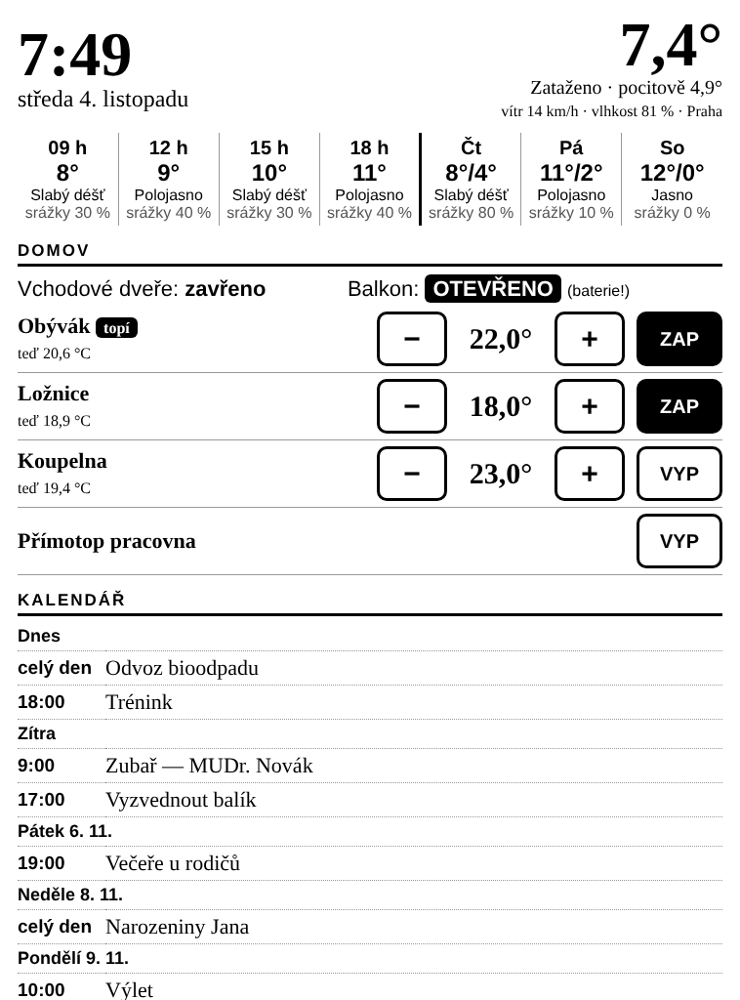

# Kindle jako domácí panel

Stará Kindle čtečka na zdi / na lince: **hodiny, počasí, kalendář, dveře a topení**.



- **Počasí** — teď + příštích 12 hodin + 3 dny ([Open-Meteo](https://open-meteo.com), zdarma, bez registrace)
- **Kalendář** — 7 dní dopředu z libovolného `.ics` odkazu (Google, iCloud, Outlook, Seznam…)
- **Dveře / okna** — Tapo T110; otevřené svítí černě, hlásí slabou baterii
- **Topení** — Tapo hlavice KE100 (− / + po 0,5 °C, zap/vyp, „topí"), případně
  zásuvka P100/P110 s přímotopem (zap/vyp), teploměr T310/T315 jen zobrazí
- Vše **lokálně v domácí síti**, žádný cloud kromě počasí a kalendáře

## Jak to funguje

```
Kindle (prohlížeč)  ──WiFi──▶  server (Raspberry Pi / NAS / PC)  ──▶  Tapo hub H100 → hlavice, senzory
                                          │
                                          └──▶  Open-Meteo, kalendář .ics
```

Kindle sám nic neinstaluje — jen ve svém prohlížeči otevře stránku ze serveru.
Stránka je psaná „postaru" (tabulky, skoro žádný JavaScript), takže ji zvládne i
staré WebKit v Kindlu. Každých 5 minut se sama obnoví; klepnutí na tlačítko pošle
příkaz a stránka se hned překreslí.

## 1. Server

Potřebuješ něco, co běží pořád: ideálně **Raspberry Pi** (stačí Zero 2 W),
nebo NAS / starý notebook. Python 3.11+.

```bash
git clone … && cd kindle-dashboard
python3 -m venv .venv
.venv/bin/pip install -r requirements.txt

.venv/bin/python dashboard.py --demo      # vyzkoušení s vymyšlenými daty
# → otevři http://<ip-serveru>:8080 v prohlížeči
```

Pak `cp config.example.toml config.toml`, vyplň a spusť bez `--demo`.
Pro automatický start po zapnutí je přiložený `kindle-dashboard.service` (návod uvnitř).

### Tapo

1. V aplikaci Tapo: **Já → Tapo Lab → Kompatibilita s třetími stranami → zapnout**.
   Bez toho novější firmware nepustí lokální ovládání.
2. Do `config.toml` dej e-mail a heslo k Tapo účtu.
3. V routeru přiřaď hubu H100 pevnou IP a napiš ji do `hosts`. (Když necháš
   prázdné, server zařízení najde sám, ale pevná IP je spolehlivější.)
4. Kontrola: `http://<ip-serveru>:8080/api/devices` vypíše, co server vidí.

Názvy na panelu jsou stejné jako v aplikaci Tapo — přejmenuj je tam.

### Kalendář

Google Kalendář (na počítači) → ⚙ Nastavení → vlevo vyber kalendář →
**Tajná adresa ve formátu iCal** → zkopírovat do `ics`. Kalendářů může být víc.

## 2. Kindle

Funguje s dotykovými Kindly (Touch, Paperwhite, Voyage, Oasis, Basic od 2014).
Starší s klávesnicí zvládnou zobrazení, ovládání je nepohodlné.

1. Připoj Kindle k domácí WiFi.
2. **Menu (⋮) → Experimentální prohlížeč** (na novějších „Webový prohlížeč").
3. Zadej `http://<ip-serveru>:8080` (s tokenem `…:8080/?k=TAJNE`), přidej do záložek.
4. V menu prohlížeče zvol **celou obrazovku**, ať nezabírá místo adresní řádek.

### Aby Kindle neusnul

Po ~10 minutách Kindle zhasne do spořiče a stránka se přestane obnovovat. Možnosti:

- **Bez úprav:** do vyhledávání na domovské obrazovce napiš `~ds` a Enter.
  Funguje jen na starších firmwarech a platí do restartu.
- **Jailbreak** (podle verze firmwaru — viz [kindlemodding.org](https://kindlemodding.org)),
  pak přes SSH / KUAL: `lipc-set-prop com.lab126.powerd preventScreenSaver 1`.
  Spořič je pak vypnutý natrvalo.

S WiFi zapnutou nepřetržitě vydrží baterie zhruba 1–2 dny, takže Kindle nech
na nabíječce (stačí jakýkoli USB adaptér).

## Bezpečnost

Server je jen pro domácí síť — **nedělej na něj port forwarding z internetu**.
Když chceš, aby topení nemohl ovládat kdokoli na WiFi (hosté), nastav `token`
v `config.toml` a do Kindlu ulož adresu s `?k=…`.

## Úpravy

Všechno je v jednom souboru `dashboard.py`: vzhled je v `CSS` a funkci `render`,
data v `fetch_weather` / `fetch_calendar` / `Home`. Podporu zařízení zajišťuje
knihovna [python-kasa](https://github.com/python-kasa/python-kasa) (umí Tapo i starší Kasa).
